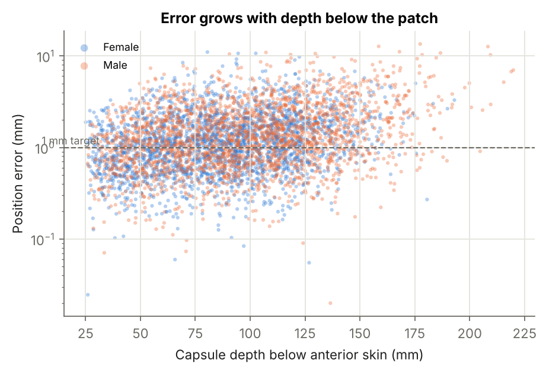

# CapsuleTrack-EM

**A patient-worn low-frequency magnetic tracking simulator for wireless capsule endoscopy.**

A wearable abdominal patch of planar coils transmits 14–31.5 kHz magnetic fields. A
3-axis coil inside the capsule senses them, and a 6-DOF solver recovers the capsule's
position and orientation. The project covers the whole chain:

1. tissue electromagnetics;
2. coil and driver design (SPICE);
3. KiCad hardware files;
4. a pose solver;
5. a Monte Carlo accuracy study across **real human body sizes (ANSUR II)**.

> **Simulation and design study only.** Nothing was fabricated or measured on hardware,
> phantoms or people.

## Key results

Nominal design: 8 coils, 80 mA, 0.5 mm / 1° patch-placement uncertainty, 1 nT ambient
interference.

| | |
|---|---|
| Tissue at 1–50 kHz | Skin depth ≥ 3.1 m, so the abdomen is quasi-static. Worst-case eddy bias ≤ 0.18 mm at 31.5 kHz (20 cm path) |
| Patch coil | 203 µH, 13.3 Ω, 65 turns over 4 layers, 0.057 A·m²/A, all derived from geometry |
| Driver (ngspice) | 80.0 mA fundamental from a 3.3 V phase-shifted bridge. A ±5 % component tolerance cuts the current by up to 16 %, so closed-loop control is needed |
| Exposure | Induced E-field 12.8–24× below the ICNIRP 2010 basic restriction |
| Accuracy, 4,800 poses / 600 subjects | **Median 1.18 mm**, 95th percentile 4.2 mm, 41 % ≤ 1 mm, orientation median 1.37° |
| Body-size effect | Median 1.00 mm in the slimmest waist-depth quartile, 1.44 mm in the largest |
| Dominant error source | Patch geometry knowledge: median 0.28 mm with exact geometry vs 1.16 mm at 0.5 mm / 1° |
| Per-patient anatomy | A fixed nominal body doubles the error (2.46 vs 1.16 mm) |
| Field model | The point dipole is inadequate near the patch (2.03 vs 1.16 mm) |
| KiCad patch | **DRC: 0 violations, 0 unconnected** (KiCad 7.0.11) |

Full write-up: [`report/CapsuleTrack-EM_Technical_Report.md`](report/CapsuleTrack-EM_Technical_Report.md)



## Data (real, public)

| Dataset | Use |
|---|---|
| Gabriel, Lau & Gabriel (1996) 4-Cole–Cole tissue parameters, *Phys. Med. Biol.* 41:2271 | Conductivity, permittivity, skin depth |
| ANSUR II public release, 4,082 men and 1,986 women | Per-subject abdomen geometry and patch shape |
| ICNIRP 2010 (1 Hz–100 kHz) | Exposure limits |

Provenance, hashes and caveats: `data/raw/*/SOURCE.md`.

## Repository layout

```
capsuletrack/      library
  tissue.py          Cole-Cole model, conductivity, skin depth, induction number
  coils.py           planar spiral geometry -> L (Maxwell mutual sums), R, moment
  field.py           exact circular-loop field (elliptic integrals), dipole field
  anatomy.py         ANSUR II loader, elliptic abdomen, conformal patch, workspace
  system.py          FDM transmitter patch, capsule receiver noise, error model
  solver.py          rotation-invariant seeding + Procrustes + Levenberg-Marquardt, CRLB
  montecarlo.py      parallel Monte Carlo + summaries
scripts/           01_tissue ... 06_kicad, run_all.py
hardware/
  ltspice/           coil_driver_14kHz / 31.5kHz  (.cir netlists + .asc schematics)
  kicad/patch/       4-layer flex transmitter patch (.kicad_pcb, footprint lib)
  kicad/driver/      driver schematic (.kicad_sch + PDF)
  kicad/bom.csv
results/tables/    every number in the report, as CSV
results/figures/   every figure in the report
report/            technical report
tests/             unit tests (field vs analytic, dipole limit, tissue, solver)
```

## Reproduce

```bash
pip install -r requirements.txt
python -m pytest -q tests            # 8 tests
python scripts/run_all.py            # all tables, figures, SPICE runs and KiCad files
```

Notes:

- `03_driver_spice.py` needs `ngspice` on the PATH.
- The KiCad files open in KiCad 7 or later. DRC was run with KiCad 7's `pcbnew` Python
  API.
- The full Monte Carlo study (script 04) takes about 10 min on 2 cores.

## Limitations

- The abdomen is an elliptic cylinder from ANSUR measurements. There is no organ
  segmentation and no respiration.
- The abdominal wall thickness is fixed.
- The ANSUR sample is military, not a patient population.
- Receiver and ambient noise levels are assumptions, varied in the sweeps.
- Metallic distortion is out of scope.
- The exposure check is a first-order estimate, not voxel dosimetry.
- Driver-schematic IC pinouts must be verified against datasheets before layout.

## Licence

Code: MIT. ANSUR II is a U.S. Government public-domain work. The tissue parameters are
cited scientific data.
