# CapsuleTrack-EM: A Patient-Worn Low-Frequency Magnetic Tracking Simulator for Wireless Capsule Endoscopy

**Sohum Vivek Dhole** · github.com/sohumdhole · Technical report, simulation and design study

> **Scope statement.** This is a simulation and hardware-design study. No hardware was
> fabricated, and no bench, phantom, animal or clinical measurement was made. Every number
> below comes from the models and public datasets described here. All results are
> reproducible with `python scripts/run_all.py`.

---

## Abstract

Wireless capsule endoscopy (WCE) would be more useful clinically if the capsule's position
inside the bowel were known. This project studies a **patient-worn transmitter patch**
that emits low-frequency (1–50 kHz) magnetic fields, sensed by a 3-axis coil inside the
capsule. It combines four elements:

- a tissue analysis from the Gabriel (1996) dielectric model;
- planar spiral coil design from first principles;
- a SPICE-verified coil driver and KiCad design files for the patch and driver;
- a 6-DOF pose solver, evaluated by Monte Carlo across **real ANSUR II body sizes**
  (4,800 poses in 600 subjects).

**Main findings**

1. **The abdomen is quasi-static across the whole band.** At 1–50 kHz, abdominal skin
   depths are 3–110 m. The worst-case eddy-current bias at 14–31.5 kHz is ≤ 0.2 mm for a
   20 cm tissue path.
2. **Accuracy with an 8-coil, 80 mA patch:**
   - median 1.18 mm and 95th percentile 4.2 mm;
   - 41 % of poses within 1 mm;
   - the median rises from 1.00 mm in the slimmest waist-depth quartile to 1.44 mm in the
     largest.
3. **The limit is knowing the patch geometry, not noise.** With exact knowledge of coil
   placement, the median error falls to 0.28 mm (83 % ≤ 1 mm). At 0.5 mm / 1° placement
   uncertainty it is 1.16 mm; at 1 mm / 2° it is 2.2 mm.
4. **Per-patient body geometry matters.** Assuming a fixed nominal body doubles the
   median error (2.46 mm vs 1.16 mm).
5. **The point-dipole approximation is not adequate this close to the coils.** Using it
   raises the median error from 1.16 mm to 2.03 mm compared with the exact loop model.
6. **The design is within exposure limits.** Induced in-tissue electric fields are
   12–24× below the ICNIRP 2010 general-public basic restriction.

---

## 1. Problem and system architecture

Capsule endoscopes travel passively through the gastrointestinal tract. Localising them
with electromagnetic (EM) tracking needs a field source and a sensor. This study places
the **sources on a wearable abdominal patch** and the **sensor in the capsule**:

| Element | Design |
|---|---|
| Transmitters | 8 planar spiral coils (4 × 2 grid, 60 mm pitch) on a 4-layer polyimide flex patch that conforms to the anterior abdomen |
| Multiplexing | Frequency division: one tone per coil, 14.0–31.5 kHz in 2.5 kHz steps. Since 31.5 < 3 × 14 kHz, no odd harmonic of any tone lands on another channel |
| Capsule receiver | 3-axis ferrite-cored coil (400 turns, 2.5 mm winding diameter, apparent μ = 15), with lock-in demodulation per tone (10 Hz bandwidth) |
| Measurements | 8 coils × 3 axes = 24 real field components per update |
| Unknowns | Capsule position (3) + orientation (3) |

## 2. Data

| Dataset | Use | Provenance |
|---|---|---|
| **Gabriel, Lau & Gabriel (1996)**, 4-Cole–Cole parameters for 14 tissues | Tissue conductivity, permittivity and skin depth at 1–50 kHz | *Phys. Med. Biol.* 41:2271; transcribed from the IFAC-CNR public appendix (`data/raw/tissue/SOURCE.md`). Check: muscle at 10 kHz evaluates to 0.34 S/m |
| **ANSUR II** (US Army 2012 anthropometric survey, public release), 4,082 men and 1,986 women | Subject-specific abdomen geometry: waist breadth, waist depth, stature | Public domain; SHA-256 hashes in `data/raw/ansur/SOURCE.md` |
| **ICNIRP 2010** guidelines (1 Hz–100 kHz) | Exposure limits | *Health Physics* 99(6):818–836 |

The tissue-property database from the IT'IS Foundation (V4.x) is built on the same Gabriel
relations. The code can take the IT'IS low-frequency conductivity table as an override
(`tissue.lf_conductivity_override`).

## 3. Tissue analysis (1–50 kHz)

Conductivity is almost constant across the band:

| Tissue | Conductivity |
|---|---|
| Small intestine | 0.53–0.58 S/m |
| Muscle | 0.32–0.35 S/m |
| Colon | 0.23–0.24 S/m |
| Fat | 0.02 S/m |

Conduction currents dominate displacement currents: the loss ratio σ/(ωε) is between 12
and 50. Using the general lossy-medium expression, the electromagnetic penetration depth
is at least 3.1 m (small intestine at 50 kHz). That is ten times the abdominal diameter,
so the field problem is **magneto-quasi-static** and tissue is effectively transparent
to the field.

The secondary (eddy-current) field was bounded by the induction number (L/δ)². The
worst case fills the whole path with small-intestine tissue and counts all of the eddy
field as in-phase (lock-in demodulation would in practice reject most of the quadrature
part). Even then, the equivalent position bias for a 20 cm path is:

| Frequency | Bias |
|---|---|
| 14 kHz | 0.08 mm |
| 31.5 kHz | 0.18 mm |
| 50 kHz | 0.28 mm |

This supports the choice of the lower half of the band and justifies leaving tissue out
of the forward model, in line with the project's "absence of distortion" framing.

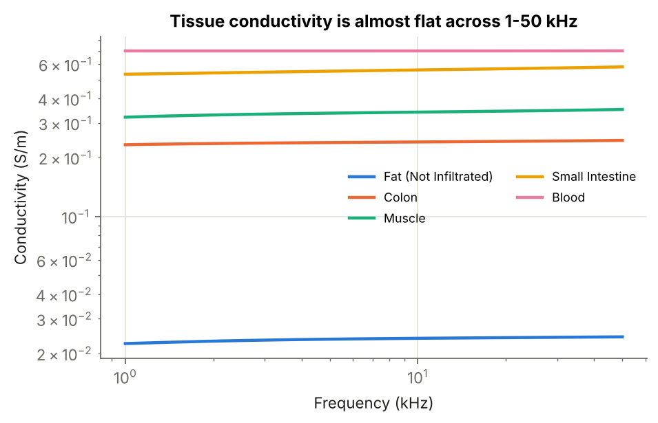
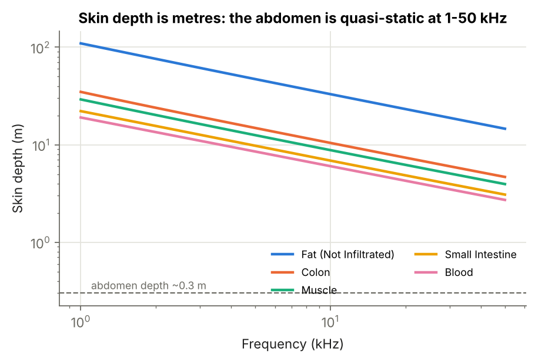
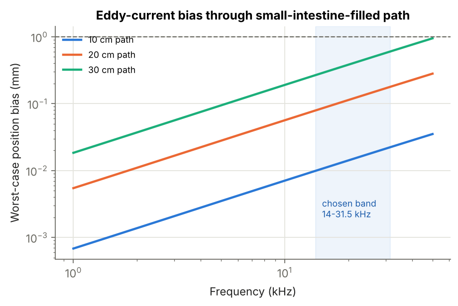

## 4. Transmitter coil design

Each coil is a 4-layer planar spiral:

| Parameter | Value |
|---|---|
| Outer radius | 20 mm |
| Trace / pitch | 0.25 mm trace, 0.45 mm pitch |
| Copper | 35 µm (1 oz) |
| Turns per layer | 16.25 + 16.25 + 16.25 + 16.125 = 64.9 turns |

The layers run inward, outward, inward, outward, so all four circulate in the same sense
and their turns add. The fractional turn counts put every via at a different angle, so a
through-via never lands on another layer's trace.

Electrical parameters are computed from the geometry, not assumed:

| Quantity | Value | Method |
|---|---|---|
| Inductance | **203 µH** | Sum of turn self-inductances + all mutual inductances (Maxwell's coaxial-loop formula); trace represented by its geometric-mean-distance radius |
| DC resistance | **13.3 Ω** | 6.76 m of trace |
| Copper skin depth at 31.5 kHz | 372 µm | Much thicker than the 35 µm copper, so AC resistance ≈ DC resistance |
| Magnetic moment | 0.057 A·m² per A | 4.6 mA·m² at 80 mA peak |

The forward field model sums the **exact circular-loop field** (complete elliptic
integrals) over all 65 turns. Unit tests check it against the analytic on-axis field and
against the dipole far field.

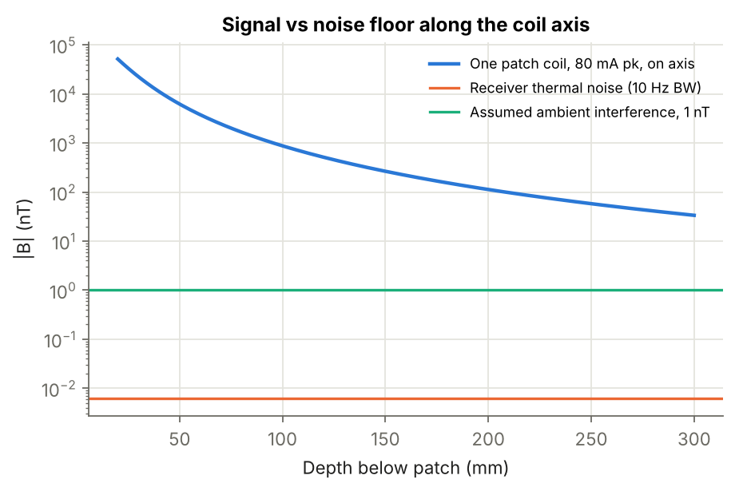

### Power and exposure

- **Power:** each channel dissipates 42.5 mW in the coil at 80 mA peak (46 mW in SPICE,
  including harmonics). The total is 360 mW for coils and drivers, or about 450 mW for
  the system.
- **Battery:** a 12 h recording needs about 5.4 Wh, roughly 1,470 mAh at 3.7 V. This is
  the main wearability cost. The sweep in §7 shows that 40 mA (a quarter of the power)
  costs only +0.12 mm of median error.
- **Exposure (`exposure_check.csv`):** the peak flux density 0.5 mm below the patch is
  359 µT rms, above the 27 µT general-public *reference level*. The reference levels
  assume uniform whole-body exposure, so the binding check is the *basic restriction* on
  the induced internal electric field (1.35 × 10⁻⁴ f V/m). Estimated from Faraday's law
  on the coil plane, the induced field is 0.15–0.33 V/m, which is **12.8× below** the
  restriction at 0.5 mm and 24× below at 5 mm. This is a first-order homogeneous estimate;
  a voxel-model dosimetry run would be the next step before any human use.

## 5. Driver circuit (LTspice / ngspice)

Each channel uses:

- a phase-shifted full bridge (DRV8837-class, 0.28 Ω combined high-side + low-side) from
  a 3.3 V rail;
- a series-resonant C0G capacitor (636 nF at 14 kHz down to 126 nF at 31.5 kHz);
- the coil;
- a 0.5 Ω current-sense resistor.

Phase-shifting the two bridge legs by φ = 31° gives a three-level output whose
fundamental is exactly the 1.12 V needed for 80 mA. Firmware closes the loop on φ using
the measured current.

The same netlists run in LTspice (`hardware/ltspice/*.cir`, `*.asc`) and in ngspice
(automated):

| Channel | Fundamental | I_rms | Coil power | THD |
|---|---|---|---|---|
| 14 kHz | 79.98 mA | 58.9 mA | 46.0 mW | 28.9 % |
| 31.5 kHz | 79.99 mA | 57.1 mA | 43.2 mW | 13.2 % |

The THD comes from the low Q (1.3–2.9) of a planar coil. The odd harmonics all fall
above the band, so the lock-in rejects them. In a 40-run tolerance Monte Carlo (C ±5 %,
L ±5 %, R +0–20 % for self-heating), the fundamental current at 14 kHz falls by up to
16 %. Closed-loop current control is therefore required, and the per-channel
current-sense amplifier provides it.

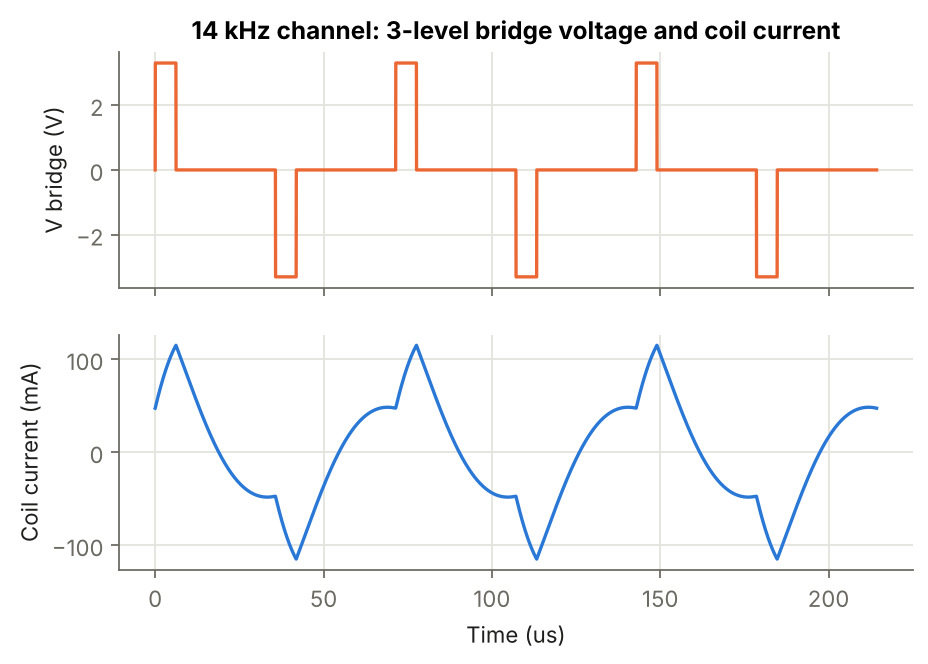
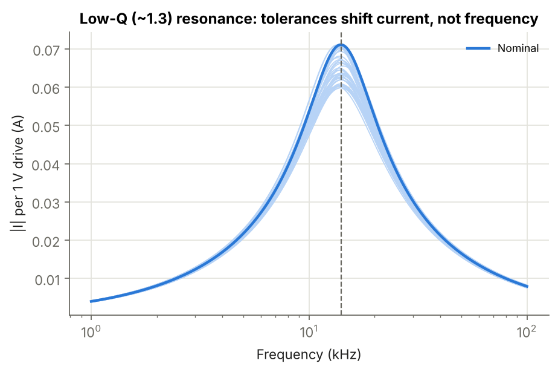

## 6. Hardware design files (KiCad 7)

- **Patch PCB** (`hardware/kicad/patch`):
  - 4-layer polyimide stack-up, 260 × 150 mm;
  - 8 coils generated programmatically from the same `SpiralCoil` object used in the
    physics (31,224 track segments, 32 vias);
  - a two-pad lead connector per coil, for a twisted-pair harness;
  - **KiCad DRC: 0 violations, 0 unconnected pads**.
- **Driver schematic** (`hardware/kicad/driver`):
  - an STM32G4-class MCU (high-resolution timer plus general timers give ≥ 16 PWM
    outputs);
  - per channel: an H-bridge, resonant capacitor, coil connector, sense resistor and
    current-sense amplifier;
  - a 3.3 V LDO, a buck converter for the driver rail, Li-Po battery input and SWD debug.
  - It is a design-intent schematic. IC pinouts must be checked against the datasheets
    before layout.
- **BOM:** `hardware/kicad/bom.csv`.

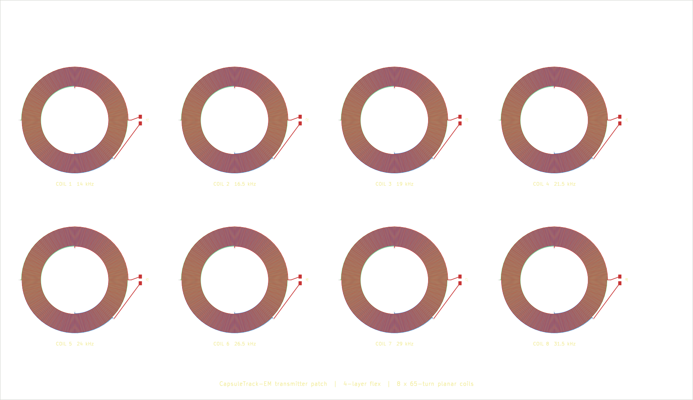

## 7. Pose estimation and Monte Carlo study

### Geometry from ANSUR II

Each subject's abdomen is modelled as an elliptic cylinder with semi-axes equal to
waist breadth/2 and waist depth/2. The patch wraps the anterior surface, so coil
positions and normals differ for every subject.

The capsule workspace is a geometric proxy for the GI tract, not an organ segmentation:

- inside the ellipse, inset by a 25 mm abdominal wall;
- anterior of −0.3 × the depth semi-axis;
- within ±0.09 × stature of the navel.

### Error budget (1σ, nominal)

| Source | Value |
|---|---|
| Receiver thermal noise | e_n = 5 nV/√Hz → about 0.01 nT equivalent field |
| Ambient interference in the tone bands | 1 nT |
| Gain / phase drift | 0.2 % per measurement |
| Coil placement uncertainty | 0.5 mm per axis and 1° normal tilt. The "true" patch differs from the solver's model by this amount, a systematic error per subject |

### Solver

1. **Rotation-invariant global seeding:** match the log field magnitudes |b_i| on a
   workspace grid, then refine position on those magnitudes. Orientation is then solved
   in closed form by weighted orthogonal Procrustes (Kabsch).
2. **Levenberg–Marquardt** over 6 DOF on noise-whitened residuals.
3. **Re-seeding** from a finer grid when the normalised χ² shows a gross misfit.

An earlier version seeded on raw vector residuals and converged to wrong minima in 0.15 %
of shallow poses. Rotation-invariant seeding removed those failures. The Cramér–Rao lower
bound is computed at every true pose.

### Results: 600 subjects (300 per sex) × 8 poses = 4,800 solves

| Group | Median | RMSE | 95th pct | ≤ 1 mm | > 10 mm | Orientation median | CRLB median |
|---|---|---|---|---|---|---|---|
| All | **1.18 mm** | 2.11 mm | 4.20 mm | 41 % | 0.3 % | 1.37° | 0.33 mm |
| Female | 1.11 mm | 1.84 mm | 3.66 mm | 45 % | 0.1 % | 1.31° | 0.26 mm |
| Male | 1.27 mm | 2.35 mm | 4.69 mm | 38 % | 0.5 % | 1.43° | 0.42 mm |

| ANSUR II waist-depth quartile | Median | 95th pct | ≤ 1 mm |
|---|---|---|---|
| Q1 (155–198 mm) | 1.00 mm | 3.37 mm | 50 % |
| Q2 (199–220 mm) | 1.13 mm | 3.79 mm | 43 % |
| Q3 (221–246 mm) | 1.24 mm | 4.13 mm | 38 % |
| Q4 (247–381 mm) | 1.44 mm | 5.28 mm | 34 % |

By depth below the skin, the median error grows from 0.82 mm (< 50 mm deep) to 2.17 mm
(150–200 mm deep). Larger bodies put the capsule further from the patch. That is the
human-centred design problem this project was set up to measure.

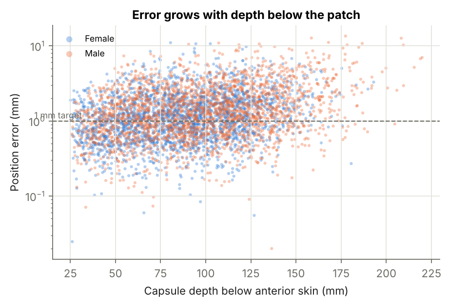
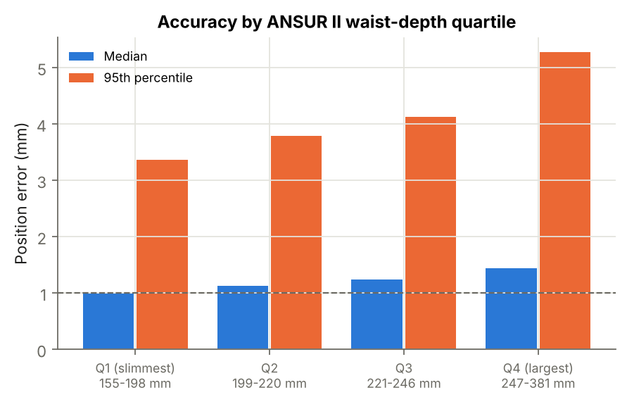
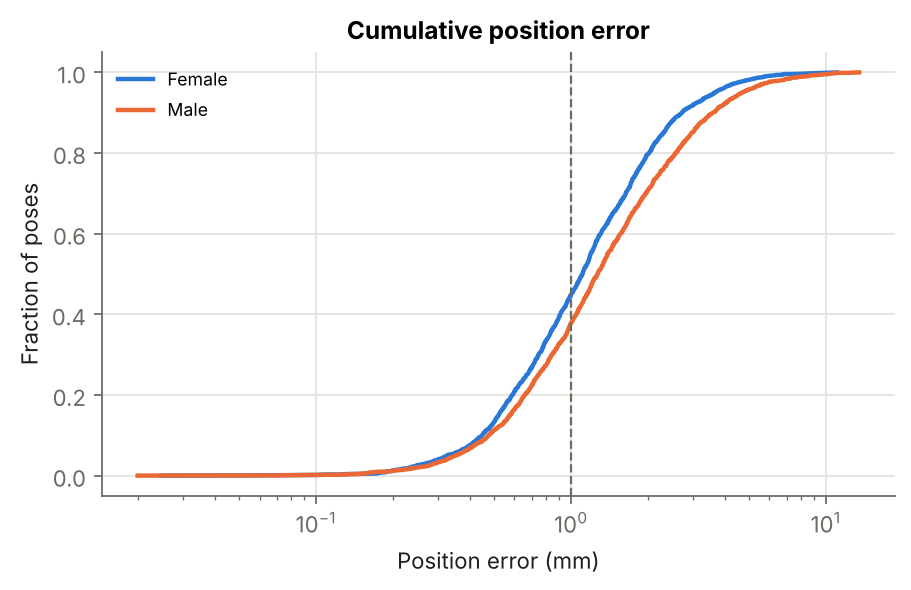

### Design-space sweeps (60 subjects × 5 poses per configuration)

| Variable | Median error | Finding |
|---|---|---|
| Coil count: 4 / 6 / 8 / 12 | 2.19 / 1.56 / 1.16 / 0.91 mm | More coils improve geometric diversity. 12 coils reach a sub-mm median |
| Ambient interference: 0.1 → 10 nT | Flat up to 1 nT, then 1.42 mm at 3 nT and 3.03 mm at 10 nT | Shielding and interference rejection matter above about 1 nT |
| Gain drift: 0 → 1 % | 1.2–1.3 mm | Not the limit |
| Patch geometry: 0 / 0.25 / 0.5 / 1 / 2 mm (with 2× degrees of tilt) | 0.28 / 0.62 / 1.16 / 2.23 / 4.47 mm | **The dominant error source** |
| Drive current: 20 / 40 / 80 / 160 mA | 1.67 / 1.29 / 1.16 / 1.11 mm | Diminishing returns above 40 mA |
| Point-dipole vs exact loop model | 2.03 vs 1.16 mm | The exact model is needed near the patch |
| Fixed nominal body vs per-patient ANSUR ellipse | 2.46 vs 1.16 mm | Per-patient geometry halves the error |
| Noise only (no systematic errors) | 0.23 mm | Close to the CRLB: the estimator is efficient |

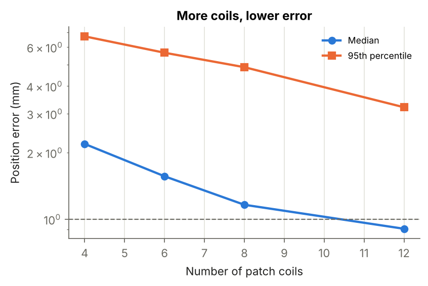
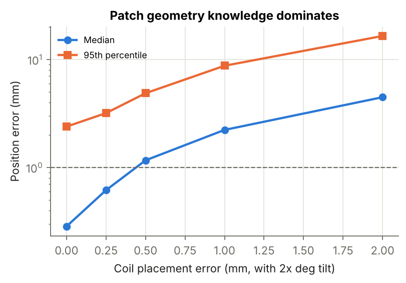
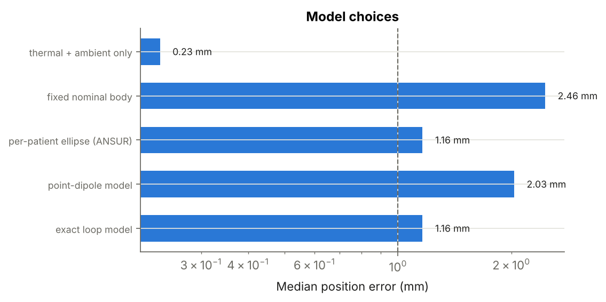

## 8. Discussion

**1 mm is reachable, but the limit is calibration, not physics.** The thermal noise floor
is about 0.01 nT and tissue is transparent, so in principle the system is limited only by
how well the solver knows where the coils are once the patch is on a curved, breathing
abdomen. That points to three concrete research directions:

1. **In-situ patch shape sensing:**
   - flex/strain gauges or an IMU array on the patch;
   - or mutual-inductance self-calibration, since each coil can sense the others.
2. **Joint estimation of patch shape and capsule pose**, for example as extra states in an
   extended Kalman filter (EKF) or factor graph. Capsule motion is slow, which helps.
3. **Anatomy-aware coil layout:** 12 coils, or a larger arc for high-waist-depth
   patients.

**Validation needed next:**

- coil-current and field-map measurements on a fabricated patch;
- a saline phantom (0.5 S/m) to confirm the eddy-current bound;
- metal-distortion tests;
- voxel-model dosimetry.

**Limitations:**

- The abdomen is modelled as an elliptic cylinder from three ANSUR measurements. There is
  no organ segmentation and no breathing motion.
- The abdominal wall thickness is fixed (ANSUR has no skinfold data).
- The ANSUR sample is military, not a patient population.
- Receiver and environmental noise values are assumptions, which the sweeps vary.
- Metallic and ferromagnetic distortion is outside scope, consistent with the target
  specification.

## References

1. S. Gabriel, R. W. Lau, C. Gabriel. The dielectric properties of biological tissues: III.
   Parametric models for the dielectric spectrum of tissues. *Phys. Med. Biol.* 41 (1996)
   2271–2293.
2. C. C. Gordon et al. 2012 Anthropometric Survey of U.S. Army Personnel: Methods and
   Summary Statistics. NATICK/TR-15/007 (2014).
3. ICNIRP. Guidelines for limiting exposure to time-varying electric and magnetic fields
   (1 Hz–100 kHz). *Health Physics* 99(6):818–836 (2010).
4. J. C. Simpson et al. Simple analytic expressions for the magnetic field of a circular
   current loop. NASA/TM-2001-210854.
5. P. A. Hasgall et al. IT'IS Database for thermal and electromagnetic parameters of
   biological tissues, V4.1 (2022). doi:10.13099/VIP21000-04-1.
